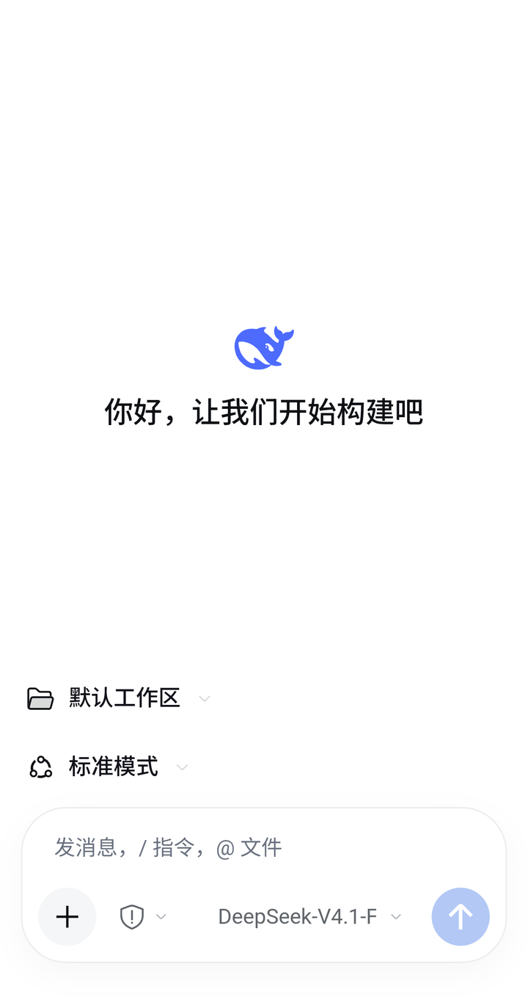
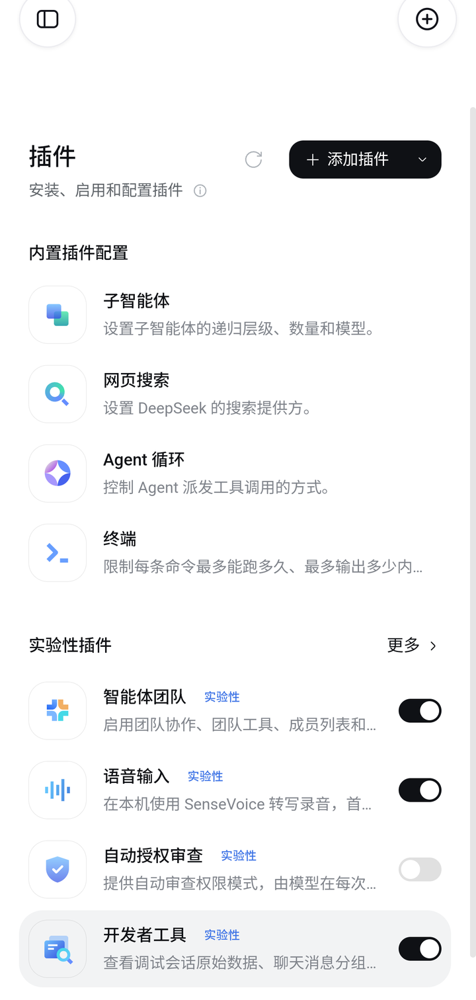
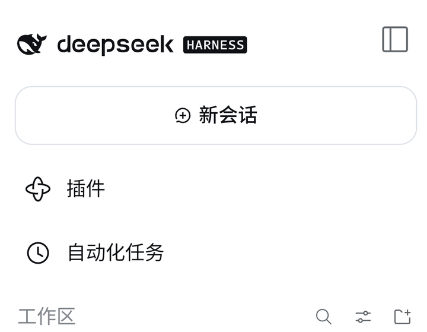

# DeepSeek Harness for Android

[](https://github.com/Chanray-May9/deepseek-harness-for-android/releases)
[](https://github.com/Chanray-May9/deepseek-harness-for-android/stargazers)
[](https://github.com/Chanray-May9/deepseek-harness-for-android/network)
[](https://github.com/Chanray-May9/deepseek-harness-for-android/issues)
[](https://github.com/Chanray-May9/deepseek-harness-for-android/commits)
[](https://github.com/Chanray-May9/deepseek-harness-for-android/graphs/commit-activity)
[](#系统要求)
[](#系统要求)

**在手机上直接运行完整的 DeepSeek Harness。** 不需要电脑，不需要服务器，不需要连任何外部地址。装好之后点图标就能用。


---

## 目录

- [它是什么](#它是什么)
- [界面](#界面)
- [快速开始](#快速开始)
- [使用指南](#使用指南)
- [系统要求](#系统要求)
- [为什么能跑在手机上](#为什么能跑在手机上)
- [从源码构建](#从源码构建)
- [仓库结构](#仓库结构)
- [常见问题](#常见问题)
- [项目状态](#项目状态)
- [已知限制](#已知限制)
- [代码位置](#代码位置)
- [致谢](#致谢)

---

## 它是什么

DeepSeek Harness 是一个把大模型能力、文件操作、命令执行、任务编排放在同一个会话里的工作环境。你和它对话，它能读你的文件、跑你的命令、改你的代码，一次对话就能推进一整件事。

它原本是为桌面键盘设计的。你在电脑终端里运行它，用文字指令组织工作流，用管线和脚本把结果接起来。

这个项目把它整个搬进了安卓应用。

不是远程连一台电脑，也不是套一层网页壳——**运行环境本身就在手机里**。安装包内带着一套精简的 Ubuntu 用户空间、一个 Node 运行时、以及 Harness 的全部代码。它们在应用自己的私有目录里解包、启动、运行，和系统其他部分互不干涉。

打开应用，你看到的是那套熟悉的界面；但操作方式按手机重做过：输入框贴在底部拇指能够到的地方，弹出层不会盖住你正要点的按钮，侧栏一次点击展开、再一次收起。

### 和电脑版有什么不同

| | 电脑版 | 这个版本 |
| --- | --- | --- |
| 运行位置 | 你的电脑 | 手机本身 |
| 安装方式 | 命令行安装 | 装 APK |
| 操作方式 | 键盘为主 | 触屏重制 |
| 终端 | 系统 shell | 内置 Ubuntu 环境 |
| 需要网络 | 仅调用模型时 | 仅调用模型时 |
| 需要 root | 否 | 否 |

功能上两者一致——同一套界面、同一套工具、同一套工作区结构。

## 界面

<div align="center">





</div>

**左**：打开应用的样子——标志、开场白、工作区与模式，输入框贴在底部。
**中**：插件页。内置插件（子智能体、网页搜索、Agent 循环、终端）可以直接调参，实验性插件用开关启用。
**右**：从左侧滑出的侧栏，新建会话、插件、自动化任务与工作区都在这里。

## 快速开始

### 1. 下载

到 [Releases](https://github.com/Chanray-May9/deepseek-harness-for-android/releases) 下载最新的 `.apk`。

包是通用包，`arm64-v8a` 和 `x86_64` 都在里面，不用挑。

### 2. 安装

手机设置里允许「安装未知来源应用」，然后点开下载好的 APK 完成安装。

安装包约 580 MB。体积来自内置的运行环境——三个压缩归档加起来就占了绝大部分。

### 3. 首次启动

点桌面图标启动。

**第一次启动需要初始化**：应用会把内置的归档解包到自己的私有目录，建立文件系统，准备运行时。这个过程视手机性能大约要一到三分钟。

屏幕上会显示当前进度。进度在动就是在正常工作，不要中途退出。初始化只发生一次，之后每次启动都在十几秒内进入界面。

### 4. 进入界面

初始化完成后直接进入欢迎页。点输入框，输入你的第一个问题。

想换模型，点输入框上方显示的模型名称。

## 使用指南

### 输入框的两种形态

输入框会自己变形，你不用管：

- **静置时**是单行胶囊，只占一条窄带，把屏幕留给内容
- **聚焦、或者已经在输入文字时**展开成双行，露出左侧工具栏、中间的模型选择、右侧的发送按钮

收回的条件是：没有文字、没有附件、也没有聚焦。三者任意一个成立，它就保持展开。

### 切换模型与推理等级

点输入框中间的模型名称，弹出两层菜单：

```
模型        DeepSeek-V4.1-Flash   ▸
推理等级                    High   ▸
```

- 点「模型」进入模型列表，选完自动关闭
- 点「推理等级」进入档位列表
- 两个菜单都是点外面关闭，不会挡住输入框

### 打开侧栏

点左上角的图标展开，再点一次收起。


### 附件

点输入框左下角的 `+`：

```
相机    照片    文件
```

三选一，选完立刻关闭。附件会以小缩略图形式显示在输入框上方，发送后清空。

### 终端

从侧栏或工作区面板进入终端。默认工作目录是 `/root/workspace`。

常用操作：

```bash
apt update && apt install -y git        # 装工具
cd /root/workspace && ls               # 看工作区
cat /etc/os-release                    # 看系统信息
```

终端和对话共享文件系统，所以在这里创建的脚本，对话里可以直接调用。

### 工作区

侧栏里的工作区可以新建和切换。每个工作区是一棵独立的目录树，会话记在自己所属的工作区下。

换工作区相当于换项目——聊天记录不会混在一起。

## 系统要求

| 项 | 要求 |
| --- | --- |
| 系统版本 | Android 8.0（API 26）及以上 |
| 处理器架构 | `arm64-v8a` 或 `x86_64` |
| 可用存储 | 建议预留 2 GB 以上 |
| 运行内存 | 建议 4 GB 以上 |
| 网络 | 与模型服务通信时需要 |

安装包约 580 MB，安装后占用会略大一些，因为运行环境要解包成普通文件。

## 为什么能跑在手机上

Android 有两道坎：默认不允许应用执行自己目录里的程序；也不提供 Linux 那样的运行时环境。

这个项目用三件事绕过去。

### 一、把 targetSdk 定在 28

Android 从 29 开始收紧了可执行文件的位置限制。`targetSdkVersion = 28` 是仍然允许从应用私有目录 `exec` 的最后一个版本区间。这是整个方案能成立的前提——没有它，内置的 Node 根本启动不了。

### 二、用 PRoot 造一个文件系统根

PRoot 是一个用户态实现：不需要 root，就能把某个目录当成 `/` 来看待。它在应用进程内部工作，用自带的 loader 把程序装进这个虚构的根里运行。

代价是启动过程比原生多几层封装，所以第一次启动会慢一些。

### 三、自带一整套运行时

APK 里打包了：

| 内容 | 作用 |
| --- | --- |
| Ubuntu 24.04 精简根 | 提供 glibc 与基础工具 |
| Node 24（glibc 版） | 运行 Harness 本体 |
| Harness 全部代码 | 界面与后端 |
| 命令行环境 | 终端功能的底座 |

启动时这些归档解包到应用私有目录，然后用 PRoot 把它们串起来。

界面是一个 WebView，加载本地启动的 Harness Web 服务。所以界面和你熟悉的一模一样，只是外面套了一层手机适配。

这套机制全部在应用沙箱内，不修改系统分区，不影响其他应用，也不需要 root。卸载应用就彻底清除。

## 从源码构建

### 需要准备

- JDK 21
- Android SDK（`aapt2`、`d8`、`zipalign`、`apksigner`）
- Node.js（跑构建脚本）

### 打包 APK

```powershell
tools/rebuild-apk.ps1 `
  -SdkRoot  <Android SDK 路径> `
  -JavaHome <JDK 路径> `
  -ProjectRoot restored/installed-0.2.1-android.5 `
  -Abi both
```

`-Abi both` 打出来的就是通用包（两个架构都有）。只给自己手机用的话可以只打对应架构，体积能省一半。

### 只改界面时的快速迭代

界面改动不需要重新打包。用这个脚本把文件推送到已连接的设备：

```powershell
tools/sync-shell.cjs
```

推送完成后**必须冷启动应用**（强制停止再打开）——单纯刷新页面不会重新加载脚本，这是实际踩过的坑。

### 运行环境归档

以下文件体积过大，没有放进仓库，需要单独生成：

| 归档 | 内容 | 量级 |
| --- | --- | --- |
| `harness-{arch}.tar.gz` | Harness 本体与依赖 | 约 150 MB |
| `node-{arch}.tar.gz` | glibc 版 Node | 约 55 MB |
| `rootfs-{arch}.tar.gz` | Ubuntu 根文件系统 | 30–80 MB |
| `termux-{arch}.tar.gz` | 内置命令行环境 | 约 30 MB |
| `loader32-{arch}.bin` | PRoot 的 32 位 loader | 几 KB |

生成脚本在 `tools/` 下：`build-*.cjs`、`build-termux-arm64.cjs`、`build-arm64-rootfs.cjs`。

### 修改界面

| 文件 | 作用 |
| --- | --- |
| `mobile/phone-shell.rc2.css` | 全部样式：布局、尺寸、间距、动画 |
| `mobile/phone-shell-ext.js` | 全部交互：胶囊、弹出层、抽屉、附件面板、事件分发 |

这两个文件是手机适配的唯一来源。改完用 `sync-shell.cjs` 推送到设备。

## 仓库结构

```
.
├── mobile/                      手机界面源码
│   ├── phone-shell.rc2.css      样式
│   └── phone-shell-ext.js       交互
├── tools/                       构建与调试脚本
├── restored/
│   └── installed-0.2.1-android.5/
│       ├── app/src/main/java/   Android 原生层
│       ├── app/src/main/assets/ 运行环境与前端资源
│       └── AndroidManifest.xml
└── README.md
```

原生层只有三个文件，各自职责清楚：

| 文件 | 负责 |
| --- | --- |
| `MainActivity.java` | WebView 宿主、JS 桥、启动遮罩、系统栏适配、文件导入导出 |
| `RuntimeInstaller.java` | 运行环境解包、PRoot 启动参数、命令行环境初始化 |
| `RuntimeService.java` | 引擎进程生命周期、日志、端口分配、启动地址解析 |

原生层三个文件加起来不到一千七百行，其余都是运行环境与前端资源。

## 常见问题

**首次启动很久，是不是卡住了？**

不是。第一次要把几百兆的运行环境解包，一两分钟属于正常。进度在动就是在工作。之后启动会快很多，通常十几秒。

**界面一直停在"连接较慢"**

正常情况下很快会进入界面。如果等了一分钟还没进去，点界面上的「重试」。仍然不行就打开应用菜单里的「查看运行日志」，最后几行能说明卡在哪一步。

这个版本已经加了两道保险：页面就绪后会主动撤掉遮罩；即使页面没有任何信号，原生层也会在 12 秒后无条件撤掉。所以正常情况下不会永久停在那一屏。

**终端里能装软件吗？**

可以。`apt` 和 `pkg` 都能用，能装常用工具。装的内容保存在应用私有目录，卸载应用会一起删掉。

**会不会影响手机系统？**

不会。整个 Linux 环境跑在应用沙箱里，不碰系统分区，不需要 root，不影响其他应用。卸载应用就彻底清除。

**占多少空间？**

安装包约 580 MB。装好之后运行环境要展开成普通文件，实际占用会更多一些。建议预留 2 GB。

**支持平板吗？**

能装能跑。界面是按手机纵向设计的，横屏和大屏上的排版还没专门优化。

**能不能连电脑上的 Harness？**

不需要。这个版本自带完整运行环境，独立工作。

## 项目状态

当前版本是 **0.2.1-android.5**，属于早期可用版本。

能跑、能用、能干活，但界面细节和交互手感还在打磨。接下来会有比较频繁的更新，包括布局调整、动画重做、交互流程简化——所以你现在看到的某些样式和操作方式，后面可能会变。

已经明确要做的方向：

| 方向 | 现状 |
| --- | --- |
| 界面细节 | 逐个界面对齐桌面版观感，按钮、间距、动效仍在调整 |
| 横屏与大屏 | 目前只按手机纵向设计，平板和横屏尚未适配 |
| 首次启动速度 | 解包环境是主要耗时，正在找更快的方案 |
| 机型覆盖 | 主要在模拟器与少数真机验证，覆盖面还会继续扩大 |

如果你在某个环节觉得别扭、卡顿、或者不符合直觉，那就是还没打磨到的地方——提 Issue 告诉我具体是哪一步，比说"不好用"有用得多。
## 已知限制

这一版还粗糙，下面这些是已经确认的问题，不是配置错误：

**运行环境相关**

- 首次启动较慢，属于解包环境的固有成本
- `$PREFIX` 指向的是应用私有目录，但它不在 PRoot 的挂载范围内，所以在终端里进不去
- 手机共享存储（`/sdcard`、`/storage`）没有挂进去，终端里看不到相册和下载的文件
- 没有 Termux:API 那套接口，取电池、剪贴板、通知这类能力目前用不了
- 系统信息是"Termux 外壳 + Ubuntu 内核"的混合状态：`/etc/os-release` 显示 Termux，但 `uname` 和 `dpkg --print-architecture` 反映的是 x86_64 的 Ubuntu

**界面相关**

- 界面按手机纵向设计，横屏与大屏未专门优化
- 部分间距、动效仍在逐个界面对齐

**工程相关**

- 运行环境归档不进仓库，需要按脚本单独生成
- 原生层是反编译恢复的代码，可读性一般

## 代码位置

改东西的时候大致是这几个入口：

| 想改什么 | 改哪个文件 |
| --- | --- |
| 界面观感 | `mobile/phone-shell.rc2.css` |
| 交互逻辑 | `mobile/phone-shell-ext.js` |
| 运行环境 | `RuntimeInstaller.java` |
| 安卓能力 | `MainActivity.java` |

界面改动用 `tools/sync-shell.cjs` 推到设备上看效果，看完记得冷启动。

## 还没解决的问题

上面「已知限制」里列的都没解决。其中这三项改起来相对独立：

1. 把 `$PREFIX` 和手机共享存储挂进 PRoot（改 `RuntimeInstaller` 的挂载参数）
2. 横屏与大屏的布局适配（改 CSS 的媒体查询）
3. 首次启动速度（分析解包耗时分布，找可压缩的部分）

## 致谢

这个项目站在一堆开源工作上。

**DeepSeek Harness** —— 界面、后端、工具系统全部来自这里。本项目做的事情是把它的运行环境搬进安卓，并在外面套一层手机适配。

**Node.js** —— 整个后端跑在它上面。glibc 版本的运行时被打包进 APK，才让 Harness 能在手机里执行。

**Ubuntu** —— 精简的根文件系统提供了 glibc 与基础工具链，是内置终端能干活的前提。

**Termux** —— 命令行环境的 bootstrap 与 PRoot 的构建都来自这个项目。没有它们，安卓上的 Linux 用户空间无从谈起。

**PRoot** —— 用户态的 chroot。不需要 root 就能把任意目录当成 `/`，是整个方案能成立的关键一环。

以及所有提交过 Issue、给过反馈的人。

如果这个项目对你有用，点个 Star 会让更多需要它的人看到：

[](https://star-history.com/#Chanray-May9/deepseek-harness-for-android&Date)


